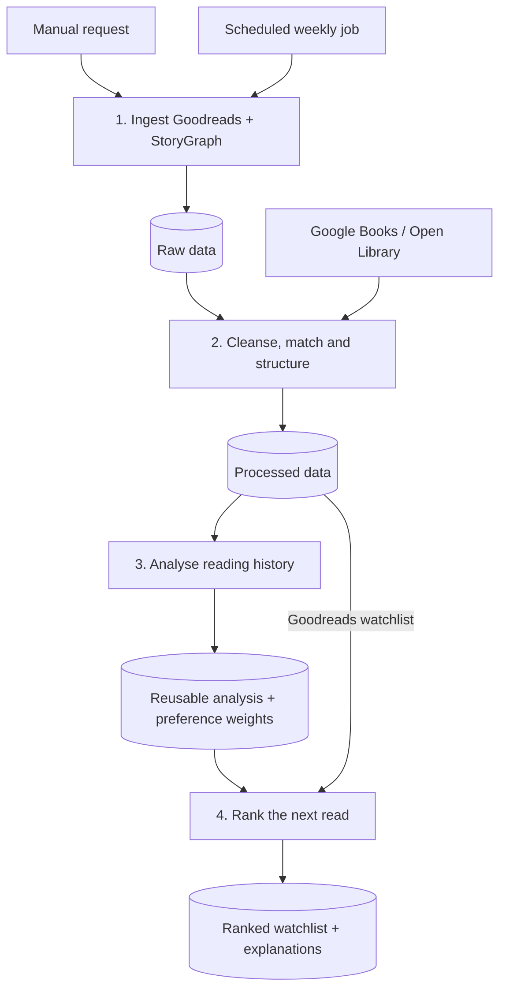

# BookyStats

Delivery progress is tracked in [TODO.md](TODO.md).

## Architecture

Four stages, with a durable database handoff between each. A manual request or
weekly job starts ingestion; downstream stages consume stored snapshots rather
than fetching the accounts again. SQLite remains the local storage layer.



Cylinders are persistent database datasets, not separate database servers.
Each downstream stage is triggered only after its input snapshot is committed.
The diagram is the target architecture, not a claim that all four stages exist.

| Stage | Responsibility | Stored output |
|---|---|---|
| **1. Ingest** | Accept manual exports from both sources first. Add authorized automatic collection for manual requests and weekly jobs next. Preserve the original content before parsing. | Immutable raw payloads, source/account binding, capture time, content hash, and batch lineage. |
| **2. Process** | Parse raw data, normalize fields, reconcile works and editions conservatively, and enrich using Google Books, Open Library, or another suitable provider. | Versioned source observations, structured books/editions, reading events, ratings/reviews, Goodreads watchlist, metadata provenance, and unresolved/missing fields. |
| **3. Analyse** | Run the agreed statistics and learn preferences from processed reading history. Keep evidence and confidence alongside findings. | Reusable statistics, features, preference weights, input snapshot references, and calculation/configuration versions. |
| **4. Rank** | Combine the saved preference weights with the processed Goodreads watchlist. | Ranked next reads, score components, explanations, confidence, and the exact input versions used. |

### Data rules

- **Raw means original:** retain every supplied source field, including fields
  that today's parser does not understand. Archive full metadata responses too,
  before selecting fields; a disposable response cache is not the raw archive.
- **Processing is replayable:** parser, cleansing, or matching improvements
  operate on the stored raw data without another account fetch.
- **Completeness is explicit:** importing every row of a file does not prove that
  the export contains every account field. Preserve missing, unsupported,
  conflicting, and failed values separately. Never invent personal history.
- **Keep provenance:** do not overwrite her ratings with community averages or
  merge editions on a title guess. Retain both sources' observations; StoryGraph
  remains authoritative for her reading history and Goodreads for her watchlist.
- **Publish safely:** retain the last usable processed snapshot when new input
  cannot be parsed or validated. Store failed-run evidence without publishing it.
- **Reuse derived work:** compare relevant input content and pipeline/configuration
  versions before recalculating. A changed watchlist can reuse unchanged taste
  weights; changed reading history invalidates affected analysis and rankings.
- **Read from the database:** viewing statistics or recommendations must not
  trigger fresh scraping or an unconditional analysis run.

### Delivery scope

**Implement stages 1 and 2 now, with manual file intake.** A user downloads the
official StoryGraph and Goodreads exports and supplies them locally; BookyStats
does not need to manage website login for that path. File ownership is explicitly
bound to the configured account, not independently verified by the CSV.

**Everything is CLI-driven.** For this initial priority, the user manually
supplies the files and explicitly runs their processing; there is no scheduled
fetch, automatic export, website, or background pipeline service to set up.
Pipeline stages are application-service boundaries with database handoffs, not a
requirement for separate servers.

**Next in queue, not P0:** the weekly scheduler/cron job and automatic source
capture or auto-export. Research those routes now, implement them later, and feed
the same raw-data boundary. On Windows the scheduler can use Task Scheduler.
Enable scheduling only after the acquisition route works reliably; reprocessing
an old export is not fresh weekly ingestion.

Stages 3 and 4 are planned next. **Personal Year in Review and Calendar Year in
Books are deferred** and can later consume these stored datasets.

This architecture and manual-first decision supersede the earlier
direct-collection-first sequencing. The detailed feature research below remains
the design reference for later statistics, ranking, and annual reviews.

## Automatic capture research

Research recorded on 2026-10-30 for the next priority, **not implemented or
live-verified as part of the manual pipeline**. Existing browser collection
attempts did not complete. The Goodreads RSS request already used the correct
numeric account ID and `shelf=to-read`; its HTTP 404 remains unexplained.

| Candidate | Evidence and limits | Next decision |
|---|---|---|
| **Goodreads official auto-export** | The library export is described by a [third-party guide](https://gist.github.com/kaayru/87385f85ec577b8e3d9613ecb09c90ca). It could feed the existing CSV processor unchanged. Download timing, session lifetime, frequency limits, and unattended operation have not been verified here. | A promising first candidate to validate against the owner's actual export flow; not a claim that a weekly job already works. |
| **StoryGraph official auto-export** | [Ryot's import guide](https://docs.ryot.io/importing/storygraph) and [Endleaf's guide](https://getendleaf.com/blog/how-to-export-your-storygraph-data/) describe export generation and email notification. These are third-party descriptions. Whether email access is essential, or an on-page link can be polled, remains unknown. | Inspect the manually supplied file and owner-visible flow before designing acquisition. Do not assume mailbox access or that login resolves the existing block. |
| **Goodreads native RSS** | A [third-party account](https://www.jordankatzen.com/posts/notes/goodreads-rss/) documents the feed mechanism. This is separate from the old developer API. This reader's feed failed; pagination and large-shelf completeness remain unverified. No fixed row cap is established by this research. | Compare accessible feed pages with known export counts before making RSS authoritative. Surface failures explicitly. |
| **Owner-authorized page capture** | Existing browser adapters can parse authorized pages, but real-account acquisition is unresolved. Saved sessions can expire. A successful ordinary-browser visit would not establish why another client was blocked. | Validate access and personal-field coverage before scheduling; preserve source controls and report reauthentication needs. |
| **Local browser extension/helper** | A possible user-triggered way to capture authorized rendered pages or structured responses in the owner's browser. It grants no additional access and does not inherently solve blocking, pagination, or missing fields. No such helper exists in BookyStats. | Consider only if it materially improves reliable capture over export/browser adapters. Weekly unattended operation is unverified. |
| **Official account API/OAuth** | StoryGraph's [API roadmap request](https://roadmap.thestorygraph.com/features/posts/an-api) remains the relevant public reference. Comments about export omissions are user testimony, not official field guarantees. Goodreads' [archived API page](https://web.archive.org/web/20210301235127/https://www.goodreads.com/api) describes historical access, not a new-app integration available today. | No usable public account-API integration was established. Do not treat private partner integrations or internal endpoints as an available public API. |

Before implementation, confirm the actual export schemas and owner-visible
download behavior, evaluate the applicable source terms (including
[Goodreads' terms](https://www.goodreads.com/about/terms)), and measure whether an
authorized session can complete repeat captures. Exact ownership, field coverage,
pagination, export readiness, and failure behavior matter more than a scraper's
feature list. No security-control evasion, credential extraction, remote sharing
of browser sessions, or silent fallback is part of this plan.

The preferred evaluation order is official auto-export into the same raw
boundary, then RSS or authorized page capture where needed for missing coverage.
Only after a route is reliable should the CLI register the weekly job. Keep
manual input available as an explicitly chosen mode.

## Status and later decisions — 2026-10-30

The detailed roadmap below preserves the earlier feature research, with intake
and delivery order revised to match the architecture above. It is **not a
statement that every capability exists or that real-account collection has
succeeded**.

| Phase | Current position |
|---|---|
| 1 — Collection and persistence | Raw-first manual capture and processing are the current implementation scope. Real exports still require reconciliation; automatic account access remains unresolved. |
| 2 — Statistical engine | Planned; not implemented. |
| 3 — Watchlist recommendations | Planned; not implemented. |
| 4 — Personal Year in Review | Deferred; not implemented. |
| 5 — Calendar Year in Books | Deferred; not implemented. |

### Decisions made after this plan was written

- **Centralized literals:** every first-party Python string/byte literal, including
  tests, belongs in `src\bookystats\strings.py`; other fixed values belong in
  `src\bookystats\constants.py`. Keep modules and folders plain and modular.
  The repository instructions define the exact policy and type-syntax exceptions.
- **Built-in reader profiles:** StoryGraph `byte_me` and Goodreads `79839274` are
  the authorized defaults. Configuration and environment overrides remain available.
  These identifiers are not login credentials and do not grant private access.
- **Current commands and output:** only `booky sync` and `booky status` are public
  commands. Terminal and JSON output exist. CSV reporting below is a future output
  idea, distinct from the now-approved manual export input.
- **Credentials:** the current Google Books connector reads its optional key from
  `GOOGLE_BOOKS_API_KEY`, not from `config.json`. Browser sessions remain local and
  isolated by source/account. A shared Playwright runtime does not share cookies
  between their browser contexts.
- **Optional providers:** Google Books and opt-in Open Library are implemented.
  Hardcover, awards datasets, and other public-year sources below remain research
  or future integration options, not installed or verified dependencies.
- **Weekly activation:** scheduling remains disabled. The implementation requires
  both accounts, two consecutive complete account runs including an unattended
  run, consistent implementation/account fingerprints, recent evidence matching
  the database, and an explicitly chosen weekday, time, and Windows time zone.
  Activation also binds subsequent scheduled execution to the implementation,
  accounts, interpreter, and schedule. Actual scheduled execution still needs
  live verification.

### Known live-access gaps

No books have been imported successfully from the configured real accounts.
StoryGraph blocked the attempted collection. The anonymous Goodreads RSS request
for `79839274` returned HTTP 404; the browser path reached sign-in, but its window
was not visible to the user in the automation runner and collection did not finish.
This does not establish that all Goodreads feeds are unavailable, that this
profile is private, or that signing in will resolve StoryGraph's block.

Anonymous collection can only use genuinely public, accessible data. A saved
owner session may support later unattended runs, but it can expire or be rejected.
Neither route may claim a complete account snapshot without evidence. Manual
exports are now an explicitly selected input route, not a hidden fallback.
No access-control workaround is permitted.

The immediate gate is raw-first manual import with reconciled file counts,
field coverage, durable processing, and replay. Automatic collection later needs
successful authorized access, repeat-run, and unattended verification.
Fixtures cannot substitute for that evidence. External links below preserve the
planning research references; their continued availability and suitability must
be checked before relying on them.

Use [README.md](README.md) for current operation,
[CONTRIBUTING.md](CONTRIBUTING.md) for development, and
[repository instructions](.github/copilot-instructions.md) for implementation
rules. The remainder preserves the agreed detailed roadmap.

---

**Manual export intake comes first.** Automatic collection later feeds the same
raw database, followed by processing, cached analysis, and watchlist ranking.

The five phases remain:

```text
Fetch and persist data
        ↓
Understand the data and generate statistics
        ↓
Recommend from her Goodreads watchlist
        ↓
Produce her Year in Review
        ↓
Produce a standalone Calendar Year in Books
```

## 1. Decisions we have settled

| Area | Decision |
|---|---|
| Language | **Python**, primarily for the statistical and recommendation work |
| Initial interface | A script with only **`booky sync`** and **`booky status`** |
| Database | **SQLite**, persisted across runs |
| StoryGraph access | Manual official export first; authorized automatic capture next |
| Goodreads access | Manual official export first; usable shelf feed or authorized page capture next |
| Metadata | Google Books API, supplemented where useful by other providers |
| Exports | **Explicit manual input for now; preserve originals in the raw database** |
| Refresh cadence | **Weekly once ingestion is stable**, with on-demand sync available |
| Normal reads | Use the database, not fresh scraping |
| Future clients | Website and app call an API built over the same application services |
| Current presentation | Terminal output, CSV, and JSON only |
| External writes | None: no changing ratings, shelves, reviews, or watchlist membership |
| AI dependency | None required for initial ingestion or core statistics |

The website and app influence how we structure the code, but they do not justify building a web server, authentication system, or multi-user infrastructure now.

---

# Phase 1 — Direct collection, persistence, and reliable synchronization

## 2. What Phase 1 must achieve

The first usable version should:

- Connect to the correct StoryGraph and Goodreads accounts.
- Retrieve all accessible records within the agreed account scope.
- Capture personal ratings and reviews—not confuse them with community data.
- Preserve reading dates and rereads where accessible.
- Identify the same book across services.
- Save everything useful in SQLite.
- Fetch missing book metadata.
- Detect changes on subsequent runs.
- Explain incomplete collection or unavailable fields.
- Eventually run weekly without needing routine intervention.

**The first milestone is a replayable raw-to-processed import of real exports.**

A library list containing book names is not enough. We need to establish access to the actual information the later phases depend on.

---

## 3. The application structure

The [architecture diagram](#architecture) is the authoritative stage layout.
Keep capture, raw storage, processing/enrichment, processed storage, analysis,
and ranking separate. Local execution can orchestrate these stages without a
message broker or separate hosted services.

The important boundary is between **application logic** and **how it is invoked**.

The CLI should not contain the synchronization or statistical logic. A future API should call the same services, not run shell commands and parse their printed output.

---

## 4. Source connectors

### StoryGraph

**First input:** the user-supplied official export, archived before parsing.
**Later automatic route:** authenticated browser extraction using Playwright and
a dedicated local browser session, subject to verified access.

The connector should investigate these surfaces:

| Surface | Required information |
|---|---|
| Completed/read library | Book identities and recorded reading history |
| Personal book/review pages | Her rating, review, and available reading attributes |
| Reading history or journal surfaces | Reading dates and separate rereads, where accessible |
| Currently reading | Current state |
| Paused and DNF collections | Separate states rather than treating everything as unread |

Existing scraper documentation is useful as a reference, but not a complete solution. The [current StoryGraph scraper](https://github.com/Tzahi12345/storygraph-api) documents list identities and catalog details, and notes that its read list deduplicates rereads. That does not establish access to all the personal data we need.

The implementation must therefore verify the real page structures and distinguish:

- Her personal rating from the community average.
- A work from a particular edition.
- A unique book from multiple reading events.
- An absent review from an extraction failure.
- An unrated book from a rating that could not be retrieved.

Manual files and automatic collection are explicit modes. An automatic run must
not pretend an old export is fresh account data or silently change intake modes.

### Goodreads

Start with the user-supplied official library export and preserve all its rows
and columns, including non-watchlist records. Derive the watchlist from its shelf
membership rather than discarding the rest of the export.

For later automatic collection, use the least complex reliable route:

1. A paginated shelf feed, if accessible and sufficiently complete.
2. Authenticated page extraction where the feed is unavailable or missing required information.

The [current Goodreads RSS client](https://github.com/icco/goodreads) demonstrates a public-shelf route, including pagination and explicit truncation handling. We still need to establish its behavior for her actual watchlist.

The connector should collect:

- Goodreads book identifier and link.
- Title and authors.
- ISBNs when present.
- Watchlist membership.
- Recorded date added.
- Custom shelves.
- Shelf ordering, if accessible.
- Available edition metadata.

Her profile should not have to become public. A private profile needs an appropriate authenticated route.

### Shared connector rule

A connector must return more than records. It must also report:

- Which account it accessed.
- Which collection it traversed.
- Whether pagination ended normally.
- Whether any pages or records failed.
- Which fields it supports.
- Which values were unavailable.
- When collection started and finished.

“Received some books” is not equivalent to “successfully synchronized the library.”

---

## 5. Initial connection and authentication

The first interactive sync should guide setup without adding a separate collection of commands.

### StoryGraph setup

- Open a dedicated BookyStats browser session.
- Let the account owner sign in normally.
- Verify that the authenticated account is the intended one.
- Store the session locally for reuse.
- Discover the accessible reading and review surfaces.

### Goodreads setup

- Record the correct reader profile identifier.
- Check whether the required shelf feed is accessible.
- Use an authenticated browser session if necessary.
- Verify account identity before importing private reading information.

A Goodreads author ID must not be mistaken for a reader profile ID.

### Credential handling

- Google Books credentials stay in local configuration or environment variables.
- Browser session state stays in a user-private application directory.
- Tokens, cookies, and authorization headers never enter source control or logs.
- The script should not require passwords to be pasted into a configuration file.

### Reauthentication

A persistent session does not mean permanent access.

When authentication expires:

- Mark the source as needing authentication.
- Keep the last valid data.
- Do not interpret a login page as an empty collection.
- Allow the next interactive run to reconnect.
- Ensure an unattended run does not sit waiting forever for input.

Normal login or browser challenges may require human interaction. We will not introduce stealth, challenge-bypass, or proxy-rotation machinery.

---

## 6. Define the collection scope explicitly

“Fetch all data” needs an accountable definition.

### Required account data

| Category | Target |
|---|---|
| StoryGraph identities | Every accessible book in the relevant reading collections |
| Personal assessments | Ratings and reviews where present |
| Reading events | Dates and rereads where the source exposes them |
| Reading states | Completed, current, paused, DNF, and other supported states |
| Reading attributes | Moods, pace, tags, and other accessible personal answers |
| Goodreads watchlist | Every accessible active watchlist entry |
| Watchlist context | Shelves, dates added, ordering, and identifiers where available |

### Separate enrichment scope

Descriptions, genres, publication dates, series, and lengths are additional metadata.

They are useful, but a missing description must not prevent a book from being stored.

### Capability states

For each source field, distinguish:

| State | Meaning |
|---|---|
| **Supported and present** | Retrieved successfully |
| **Supported but empty** | The source genuinely has no value |
| **Unavailable for this record** | The source does not expose it here |
| **Unsupported by the connector** | We have not implemented or established extraction |
| **Failed to retrieve** | An error prevented collection |

This distinction is essential. Otherwise a broken selector can turn an entire collection into “unrated books.”

---

## 7. The first full synchronization

The initial manual sync must archive the original files from both sources before
parsing, then validate schemas and row counts, process/enrich, and publish a
processed snapshot with raw lineage. Repeat processing must not require the
original download paths or website access.

For later automatic collection, the capture stage should perform the following
source-discovery steps before handing stored raw data to processing.

### Establish identity

Confirm which reader each connection represents before collecting or updating data.

### Enumerate collections

Traverse all relevant pages or feed pages.

Record:

- Page progress.
- Source identifiers.
- Pagination state.
- Available totals.
- Normal termination versus unexpected truncation.

### Retrieve personal details

Fetch the fields needed beyond the collection listing.

Prioritize correctness over assuming that every visible star value is her rating.

### Commit raw capture

Save source content and collection evidence before parsing or cleansing.
Processing consumes this durable boundary, not in-memory fetch results alone.

### Normalize records

Convert source-specific representations into common structures while retaining the original values and provenance.

### Reconcile book identities

Link records that demonstrably refer to the same work or edition.

Keep ambiguous cases visible.

### Persist account observations

Save validated records and the evidence needed to explain the collection.

### Enrich metadata

Fetch missing information using suitable providers and cache it.

### Publish a usable snapshot

Make the completed source snapshot available to downstream calculations.

### Produce a receipt

Report what was collected, what changed, and what remains incomplete.

The first run may take substantially longer than later runs. We should not promise a completion time before seeing the size of the library and the source’s pagination behavior.

---

## 8. Pagination and completeness

This is a central correctness concern, particularly for a large watchlist.

The collector must handle:

- Explicit next-page links.
- Feed page parameters.
- Infinite scrolling where that is the supported interface.
- Repeated pages.
- Empty responses.
- Provider-imposed page or row caps.
- A collection changing while it is being traversed.

### Evidence of completeness

Use the evidence available from each source:

- Pagination terminated normally.
- No page failed.
- No unexplained repetition occurred.
- Retrieved identifiers reconcile with available collection totals.
- Totals are being compared in the correct units.

For example, a source’s “reads” total may count rereads while its list contains unique books. Those numbers must not be compared as though they mean the same thing.

A traversal stopped by a configured limit is **partial**, not complete.

### Resuming interrupted work

Resume only when the checkpoint is still meaningful.

An offset into a changing collection may no longer point to the same records. Where necessary:

- Re-enumerate membership safely.
- Reuse already collected book details.
- Resume detail fetching by stable source identifiers.

Idempotent persistence makes replay safe: processing the same record again does not create duplicates.

---

## 9. Canonical data model

The database should preserve several distinct concepts.

| Entity | Purpose |
|---|---|
| **Source account** | Which reader and service the data belongs to |
| **Work** | The underlying book |
| **Edition** | A particular format, language, publisher, or ISBN |
| **Source record** | The service-specific identity and original observations |
| **Reading event** | A particular reading attempt or completion |
| **Personal assessment** | An observed rating or review |
| **Watchlist membership** | Whether a Goodreads entry is currently on the watchlist |
| **Metadata observation** | A provider’s value and when it was obtained |
| **Match decision** | How source identities were connected |
| **Sync run** | Collection progress, outcomes, and freshness |
| **Derived result** | A statistic or recommendation tied to particular inputs |

These are logical entities. They do not all need separate elaborate subsystems on day one.

### Work versus edition

A paperback and audiobook may represent the same work but have different:

- Length measurements.
- Narrators.
- Translators.
- Publication dates.
- Publishers.
- ISBNs.

Work-level matching should not erase edition-level information.

### Reading event versus current state

A book may have:

- Been completed previously.
- Been reread later.
- Currently be in progress again.

A single current status cannot replace the reading history.

### Assessment versus reading event

If the source exposes one current rating for the book, store that fact.

Do not duplicate it into invented historical ratings for every reread.

---

## 10. Identity matching

### Matching order

1. Previously confirmed mappings.
2. Valid ISBN matches with consistency checks.
3. Explicit cross-provider identifiers.
4. Supported title-and-author matches.
5. Candidate matches awaiting resolution.

### Required checks

- Validate ISBN structure and checksum.
- Preserve ISBN-10 and ISBN-13 relationships correctly.
- Do not interpret arbitrary StoryGraph UIDs as ISBNs.
- Distinguish translators, editors, narrators, and authors where possible.
- Keep original titles for display.
- Normalize punctuation and spacing only for matching.
- Use verified alternate titles rather than guessing translations.

### Difficult cases

Explicitly handle:

- Omnibuses and their component books.
- Short stories versus collections.
- Revised editions.
- Abridged audio editions.
- Different works with identical titles.
- Authors sharing a name.
- Series labels embedded in titles.

### Match outcomes

Use understandable states:

- Confirmed.
- Likely but unconfirmed.
- Unresolved.
- Conflicting.

Do not present a heuristic matching score as a calibrated probability.

Manual corrections must survive later syncs and remain reversible.

---

## 11. Provenance and time

For important values, retain:

- Source.
- Source record identifier.
- Scope: reader, work, or edition.
- Value.
- Observation time.
- Source-provided effective time, if available.
- Whether it was extracted, normalized, or inferred.

### Keep different timestamps separate

| Timestamp | Meaning |
|---|---|
| **Source date added** | When the service says the book was added |
| **First observed locally** | When BookyStats first saw it |
| **Last checked** | When the connector last examined it |
| **Source update time** | When the source says it changed, if exposed |
| **Last successful collection** | When the relevant collection completed successfully |

First observed locally must not become the date she originally became interested in a book.

### Preserve date precision

A year-only date remains year-only.

A month-only date remains month-only.

Date-only reading records should not be shifted through time zones as though they were precise UTC events.

Operational timestamps can use UTC, while report calendar boundaries use an explicitly defined reporting time zone.

---

## 12. Detecting changes on later syncs

Later syncs need to detect more than newly added books.

| Change | Required behavior |
|---|---|
| New completed book | Add the work/edition and reading information |
| Revised rating | Record the new assessment observation |
| Edited review | Preserve the changed review and observation time |
| Reread | Add a separate event if the source exposes it |
| Changed reading status | Update current state without destroying history |
| New watchlist entry | Add membership and source context |
| Removed watchlist entry | Mark membership inactive after reliable reconciliation |
| Changed edition | Preserve the relationship without creating an unrelated work |
| Corrected metadata | Update the selected value while retaining provenance |

### Incremental collection where reliable

Use change timestamps, feeds, or collection-level indicators only when they genuinely cover the fields we care about.

A new-book feed may not report:

- An edited review on an older book.
- A changed old rating.
- A removed shelf entry.
- Corrected reading dates.

### Reconciliation where necessary

Where there is no trustworthy change signal, revisit enough of the collection and detail pages to establish current state.

**Caching does not remove this requirement.**

We should optimize duplicate work, but not claim a fully current account after checking only its newest books.

---

## 13. Database updates and partial failure

### Stage before publishing

Collection should not overwrite the current usable dataset with half a run.

A suitable approach is:

1. Collect and validate observations in a staging run.
2. Track completeness for each source and collection.
3. Publish validated snapshots atomically.
4. Retain the previous usable snapshot when a required stage fails.

Network activity should not hold a long SQLite write transaction open.

### Independent source outcomes

StoryGraph can fail while Goodreads succeeds.

The run should report that accurately rather than declaring everything failed or everything current.

Downstream outputs must know which source snapshots they are using.

For example:

- Historical statistics may remain usable from the last StoryGraph snapshot.
- Watchlist recommendations may need to disclose that reading history is older than watchlist membership.

### Removal rules

Never remove local membership because:

- Authentication expired.
- A page failed.
- Pagination stopped early.
- A feed returned an error.
- The collector encountered an unexpected layout.

Only a sufficiently complete reconciliation can establish that an entry is absent.

Keep historical membership observations rather than deleting the book itself.

---

## 14. Metadata enrichment and caching

### Google Books

Your key is useful for:

- ISBN and title/author lookup.
- Descriptions.
- Categories.
- Publication information.
- Page counts.
- Language.
- Available community ratings.

It does not authenticate StoryGraph or Goodreads.

Use the [documented public-data API-key flow](https://developers.google.com/books/docs/v1/using). The project’s actual quota should be read from its configuration rather than assumed.

### Open Library

Useful for work/edition relationships, identifiers, subjects, and bibliographic information.

Its [API guidelines](https://openlibrary.org/developers/api) explicitly discourage bulk per-book harvesting. A large library needs permitted batching, reuse, and an appropriate bulk route where necessary—not simply thousands of individually throttled requests.

### Hardcover

Optional enrichment for richer catalog information, series, aggregate reception, and audio duration.

Use a catalog-read token and respect the current [API contract](https://docs.hardcover.app/api/getting-started/). The connector should not need access to other users’ private libraries.

### Cache by the nature of the field

| Field type | Refresh behavior |
|---|---|
| Stable identifiers | Reuse unless conflicting or corrected |
| Descriptions and classifications | Refresh when missing, stale, or explicitly revisited |
| Publication and edition details | Cache, but allow corrections |
| Community ratings and counts | Keep dated observations; refresh for current reception analysis |
| Personal ratings and reviews | Follow the account synchronization policy |

Cache age and successful retrieval are separate concepts. A failed refresh must not reset the freshness timestamp.

### Large-library behavior

Account collection and metadata enrichment have separate completion states.

We can have:

- A complete Goodreads watchlist.
- Complete StoryGraph personal records.
- Incomplete metadata enrichment.

That is a useful, honest state—not a failed project and not “everything complete.”

---

## 15. Weekly ingestion once stable

### The scheduled operation

A weekly job invokes the same sync service used by `booky sync`.

It should:

1. Check connection health.
2. Reconcile account collections and personal details.
3. Persist successful source updates.
4. Refresh required metadata.
5. Save dated observations.
6. Refresh affected derived results once those phases exist.
7. Record a clear receipt.

### Activation criteria

Do not enable the schedule merely because one interactive run succeeded.

Before activation, establish that:

- The collector can traverse the complete intended collections.
- A repeated run does not create duplicates.
- Older edited records are detected.
- Failures do not erase data.
- Interrupted work can recover.
- Sessions are reusable.
- The actual scheduled execution context works.
- An unattended run handles expired authentication without hanging.

This does not require waiting several weeks. Repeated runs and controlled fixtures can establish much of the behavior.

### Scheduling locally

For the initial Windows script, an OS-level scheduler is appropriate.

It should not depend on a Copilot conversation remaining open.

Choose the weekday, local time, and time zone when scheduling is activated. Configure missed-run behavior so a powered-off machine does not silently appear current.

Browser execution also needs to work in that environment. A connector that only works during an interactive desktop session is not yet a proven unattended connector.

### Prevent overlapping runs

Manual and scheduled runs must not update the same account simultaneously.

Use one active synchronization per reader/database, with a clear “already running” outcome rather than launching duplicate crawls.

### Failure behavior

- Transient failures receive bounded retries.
- Expired authentication requires reconnection.
- Unsupported page changes stop the affected extraction path.
- Last good data remains readable.
- The next run resumes or safely reconciles again.
- No failure triggers an export-based fallback.

---

## 16. What weekly snapshots make possible

Snapshots are useful beyond recovery.

They can eventually support:

- Changes to personal ratings.
- Revisions to reviews.
- Observed watchlist additions and removals.
- Changes in recommendation rankings.
- Community reception movement.
- Prospective recommendation evaluation.

But weekly observations are not a complete event stream.

A book added and removed between two syncs may never be observed. A rating change may only be known to have occurred between two observations unless the source supplies an exact update time.

Reports must describe **observed changes**, not claim perfect historical event coverage.

Snapshots begin when we start collecting them. They do not reconstruct earlier years automatically.

---

## 17. `booky status`

The status command should read the database without contacting external services.

It should answer:

| Area | Information |
|---|---|
| Connections | Configured, usable, or needing authentication |
| Freshness | Last successful collection for each source |
| Completeness | Complete, partial, unresolved, or unsupported portions |
| Library | Source records, resolved works, editions, reading events |
| Watchlist | Active membership and unresolved identities |
| Personal data | Rating, review, and date coverage |
| Metadata | Coverage for descriptions, genres, series, length, publication dates |
| Recent run | Added, updated, removed-from-shelf, unchanged, and failed records |
| Scheduling | Whether enabled, last outcome, and next expected run when available |

This should be concise enough to use routinely, with more detailed structured information available internally.

No new command family is needed for every subsystem.

---

## 18. Phase 1 completion

The deliverables are:

- Working direct source connectors.
- Persistent SQLite storage.
- A unified, source-aware library.
- Repeatable synchronization.
- Accurate completeness and freshness reporting.
- Resumable metadata enrichment.
- A verified unattended path before weekly scheduling is enabled.

The important correctness cases include revised old ratings, edited reviews, rereads, private profiles, pagination failures, unknown statuses, ambiguous books, and interrupted runs.

Those cases should be exercised using controlled data and fixtures—not by automatically altering her real reading history.

---

# Phase 2 — Understand the data and build the statistical engine

## 19. Let the collected data determine the analyses

The first statistical output is a capability inventory.

| Classification | Meaning |
|---|---|
| Supported | Required fields are available |
| Supported for a subset | The result can be calculated with a stated denominator |
| Needs enrichment | A catalog field is missing |
| Needs more observations | Future snapshots or more reading history are required |
| Unsupported | The available data cannot honestly answer it |

This should identify which advanced ideas are practical before we build them.

The aim is not to produce fifty weak metrics. It is to produce a smaller set of interesting, defensible findings and expand as the evidence improves.

---

## 20. The statistical questions worth pursuing

### Enjoyment versus exposure

A category she reads often is not automatically a category she enjoys most.

Compare:

- How much of her reading belongs to it.
- Her rating distribution within it.
- Its frequency among higher-rated books.
- Whether the result depends on one author or series.

This can distinguish familiar habits from reliable enjoyment.

### Conditional preferences

Single labels are often too broad.

Potential questions:

- Does slow pacing work better when a book is character-focused?
- Does she enjoy long books more in some categories than others?
- Does a familiar author change her tolerance for unfamiliar subjects?
- Are certain combinations associated with stronger ratings than either feature alone?

These analyses need adequate support. We should not manufacture conclusions from one or two books.

### Review-supported preferences

Ratings tell us whether she enjoyed a book. Reviews may explain why.

Candidate themes:

- Character development.
- Emotional impact.
- Prose.
- Pacing.
- World-building.
- Relationships.
- Ideas and learning.
- Predictability.
- Ending satisfaction.
- Repetition.
- Narration.
- Length.

Every extracted theme should retain supporting text and its source book.

### Taste changes

Compare earlier and later reading while distinguishing:

- Changes in the books selected.
- Changes in ratings within comparable groups.
- Changes in metadata coverage.
- Later revisions to old ratings.

A different genre mix can change the overall average without any category becoming more enjoyable.

### Author and series reliability

Explore:

- Consistency rather than only average rating.
- Whether an author’s apparent strength rests on one book.
- Differences between starting and continuing series.
- Concentration of favorites within a small set of authors.

### Reading breadth

Use consistent classifications to describe how concentrated or varied her reading is.

Where comparing years with different numbers of books, use a comparable-volume approach rather than allowing a larger year to appear broader merely because it contains more observations.

### Watchlist mismatch

Compare the composition of her Goodreads watchlist with supported preferences from her reading.

This can reveal:

- Categories heavily represented in the backlog but weakly supported by enjoyment.
- Strong preferences with surprisingly few candidates.
- Older entries that still fit well.
- Areas where she has too little experience to draw a conclusion.

### Community agreement

Compare her ratings with a named provider’s community ratings on matched books.

Do not combine all platforms into an invented universal consensus.

### DNF patterns

Keep DNF separate from low ratings.

Where available, distinguish explicit reasons such as:

- Wrong timing.
- Pacing.
- Writing style.
- Content.
- Lack of interest.

A blank rating on an abandoned book is not a zero-star rating.

---

## 21. Read Your Color-inspired dimensions

Use the idea of reading appetites to go beyond genre.

The [Read Your Color site](https://readyourcolor.com) describes dimensions around feeling/thinking and grounded/imaginative reading, alongside wonder, surprise, intensity, meaning, connection, and clarity.

For BookyStats:

- A reader can value several dimensions simultaneously.
- The dimensions do not need to sum to 100%.
- They are not a diagnosis or permanent identity.
- We do not claim to reproduce the site’s assessment.

Maintain three views:

| View | What it describes |
|---|---|
| Declared preferences | What she explicitly says she wants |
| Reading exposure | Characteristics present in books she reads |
| Enjoyment associations | Characteristics associated with her ratings |

Disagreement between those views can be useful.

### Label quality matters

Book-level labels can come from:

- Her explicit answers.
- Provider classifications.
- Well-defined interpretation of descriptions.
- Optional local text analysis.

Each label needs an origin and an appropriate reliability description.

If the data supports mood and pace but not a nuanced “meaning” dimension, report mood and pace. Do not invent the rest to complete a profile.

---

## 22. Statistical methods and safeguards

### Define the population

Every metric should identify whether it uses:

- Unique works.
- Reading events.
- Rated completed books.
- All completed books.
- Current watchlist entries.
- A specific time period.

Rereads should not silently change the denominator.

### Preserve missing values

Missing ratings, unknown page counts, and absent genres do not become zero.

### Adjust thin samples

A category with one five-star book should not automatically beat a category with many consistently strong books.

A transparent adjusted mean can use:

```text
adjusted mean =
(group rating total + prior strength × overall mean)
÷
(group sample size + prior strength)
```

The adjustment must be documented. It is not a device for making results look impressive.

### Describe uncertainty appropriately

Use intervals or stability checks where their assumptions are reasonable.

Where evidence is too limited, say so rather than rendering a precise-looking percentage.

Repeated books from one series or author may require grouped treatment rather than assuming every observation is independent.

### Avoid finding patterns by sheer volume

If we examine hundreds of combinations, some will look impressive by chance.

Use a manageable set of planned comparisons, report support, and distinguish exploratory findings from patterns that remain stable under further data.

### Separate association from causation

“Higher ratings among books with this characteristic” is supportable.

“This characteristic causes her enjoyment” generally is not.

---

## 23. A common result format

Each statistical finding should carry:

- A stable metric identifier.
- The population.
- Time period.
- Value and unit.
- Comparison baseline.
- Sample size.
- Missing-data count.
- Reliability or uncertainty information.
- Supporting book identifiers.
- Calculation version.
- Source snapshot references.
- Relevant limitations.

Human-readable text is generated from that result.

CSV, JSON, and a future API should not independently recalculate the same metric.

### Phase 2 completion

The statistical engine should produce meaningful findings that can be traced to records and calculations.

Unsupported ideas remain visible in the capability inventory rather than being implemented as guesses.

---

# Phase 3 — Rank the Goodreads watchlist

## 24. Candidate eligibility

The primary candidate pool is her active Goodreads watchlist.

Before scoring:

- Exclude confirmed completed works unless rereads are explicitly included later.
- Keep currently reading books out of a “start next” list.
- Separate paused and DNF reconsideration candidates.
- Collapse duplicate editions appropriately.
- Flag unresolved possible matches to already-read books.
- Exclude known unreleased titles from immediate-next-read suggestions.
- Apply explicit language, format, length, and content constraints when supported.

Series position should not automatically imply a mandatory prerequisite. Companion books, prequels, and optional novellas need different treatment.

Unknown metadata must remain visible. A book with unknown length cannot be confidently described as satisfying a strict page limit.

---

## 25. Build the recommender in layers

### Transparent baseline

Start with:

- Similarity to previously enjoyed books.
- Similarity to explicitly disliked books.
- Supported genre, mood, pace, and other preference associations.
- Author or series familiarity.
- Explicit current-reading preferences.
- Known conflicts and constraints.

Community popularity is a secondary signal, not the main objective.

### Learned ranking

Once the data supports it, evaluate a regularized model using shared book metadata and text features.

The model should earn its place by improving over the simpler baseline.

Do not add a large model merely because recommendations sound like an AI problem.

### Align training and prediction features

This is especially important.

We cannot train using her post-reading answers for a book and then assume the same answers exist for unread candidates.

Use features available for both historical and unread books. Her personal reviews and answers can help form her preference profile, but the target book’s future personal review is unavailable.

---

## 26. Recommendation modes

The engine can eventually support several purposes without needing separate implementations.

| Mode | Purpose |
|---|---|
| **Best fit** | Strongest match to established preferences |
| **Explore** | A supported departure from familiar reading |
| **Rediscover** | Promising older watchlist entries |
| **Current appetite** | Match an explicitly requested reading experience |
| **Constraints** | Work within supported length, format, language, or series preferences |

These are future capabilities, not commands we need to add now.

“Explore” should mean different from her own history—not universally strange, difficult, or experimental.

---

## 27. Full ranking versus a useful shortlist

Produce both:

- A ranked view of the eligible watchlist.
- A shortlist with sensible variety.

A purely sorted list can fill its first ten positions with one author or series.

Shortlist selection can account for author, series, category, length, and reading appetite while preserving strong personal fit.

Unrankable records should remain present with reasons. They should not disappear from the output or receive arbitrary low scores that imply dislike.

---

## 28. Explain every recommendation

Each result should include:

| Information | Purpose |
|---|---|
| Book and edition identity | Avoid recommending the wrong work |
| Main supporting reasons | Show the strongest evidence |
| Relevant books she enjoyed | Make the match concrete |
| Potential mismatch | Explain why it might not work |
| Missing information | Expose uncertainty |
| Recommendation mode | Explain the selection objective |
| Original watchlist context | Preserve date added and source priority where available |

Confidence has separate components:

- Correct identity.
- Sufficient metadata.
- Sufficient evidence about her preferences.

A single unexplained “92% match” hides those differences.

If we expose an internal ranking score, label it as a ranking score—not a probability of enjoyment.

---

## 29. Evaluate without misleading ourselves

Use time-ordered evaluation when dates and history permit.

Protect against:

- Using the target book’s own review to predict its rating.
- Splitting rereads of the same work across training and evaluation.
- Treating unread books as dislikes.
- Using future publication or award information in a purported historical prediction.
- Pretending today’s watchlist was the watchlist years ago.

With only current source observations, early evaluation may be retrospective rather than a faithful historical simulation.

Useful measures include:

- Whether higher-rated held-out books rank above lower-rated ones.
- Ranking quality within the observed evaluation set.
- Performance on unfamiliar authors.
- Candidate coverage.
- Shortlist variety.
- Stability when small amounts of data change.

Future recommendation snapshots allow more honest prospective evaluation.

A book recommended and later read is evidence of sequence—not proof that the recommendation caused the choice.

### Phase 3 completion

The engine should produce an explainable watchlist ranking with correct eligibility, traceable evidence, and useful handling of uncertainty.

---

# Phase 4 — Her Year in Review

## 30. Define the personal year

The main population is:

> Books she completed during the selected calendar year, regardless of their publication year.

Report unique works and recorded completions separately.

Additional sections can cover starting, pausing, abandoning, or continuing books only when the source provides suitable dated information.

A report for the current year is labeled year-to-date.

---

## 31. Personal annual report contents

| Section | Contents |
|---|---|
| **The year in numbers** | Works, completions, rereads, rated books, new-to-her authors |
| **Favorites** | Highest-rated books, ties, and review-supported reasons |
| **Unexpected successes** | Strong results outside established expectations |
| **Taste profile** | Supported characteristics associated with enjoyment |
| **What changed** | Comparisons with earlier reading |
| **Reading sequence** | Runs of authors, series, categories, or supported moods |
| **Exploration** | New-to-her authors, categories, languages, and publication eras |
| **Returning favorites** | Rereads and continued authors or series |
| **Watchlist movement** | Observed additions, removals, and completed watchlist books |
| **Unfinished reading** | Separate treatment of DNF, paused, and ongoing books |
| **Personal distinctions** | Review-supported highlights such as prose or emotional impact |
| **Next reads** | Recommendations from the existing watchlist |

### Unexpected favorites

A surprise should be measured against an appropriate prior expectation, not simply defined as “a highly rated book in an unfamiliar genre.”

If a sound comparison is unavailable, use a modest descriptive label instead.

---

## 32. Personal annual measurement rules

### Pages

Where edition data permits, report **pages in completed books**.

Do not present this as exact pages actively read during the year. Some books cross calendar boundaries, and partial reading may be unknown.

### Audio

Report known edition duration separately from actual listening time.

### Reading duration

Start and finish dates support elapsed calendar duration, not active reading hours.

### Daily activity

Completion dates support “books finished on this day,” not daily reading streaks.

### Ratings

If only current ratings are available, report current ratings of books completed that year.

Weekly snapshots can improve future historical accuracy, but do not repair earlier missing history.

### Year-over-year comparisons

Compare equivalent periods where possible and show differences in coverage.

A larger or better-enriched dataset can create apparent changes that do not reflect a real change in reading.

### Phase 4 completion

The personal review should reuse the statistical engine, apply correct calendar boundaries, and avoid inventing activity or historical assessments.

---

# Phase 5 — Calendar Year in Books

## 33. A genuinely standalone public report

The general annual review should work without her account.

Its core dataset and report should contain public catalog and aggregate information only.

Personalization is a later join:

```text
Public annual dataset
        ↓
General Year in Books
        ↓
Optional comparison with her history and watchlist
        ↓
New personalized discoveries
```

---

## 34. Separate the different meanings of “this year”

| Cohort | Meaning |
|---|---|
| **Published that year** | Works with an eligible first publication in the selected year |
| **New in a language or market** | Relevant translations or new availability |
| **Awarded that year** | Books receiving awards during that calendar year |
| **Read during that year** | Requires suitable dated activity data |
| **Popular when observed** | Current or rolling reception and activity |

These cannot be mixed into one unlabeled leaderboard.

A reprint is not automatically a new work. A translation can be a significant new release without changing the original work’s publication year.

---

## 35. Keep publication year and observation date separate

An annual report has two independent time dimensions:

- Which year the books belong to.
- When their reception was measured.

This is valid:

> Books first published in 2025, using reception observed in October 2026.

This requires historical evidence:

> The highest-rated books at the end of 2025.

Open Library’s yearly trending feed is a rolling 365-day window. Hardcover’s [documented trending queries](https://docs.hardcover.app/api/graphql/schemas/books/) also use windows.

Neither is a substitute for arbitrary January-to-December activity.

Weekly snapshots will improve future analysis, but only from the point collection begins.

---

## 36. Build a declared annual dataset

Candidate sources can include:

- Catalog queries for the release cohort.
- Source-specific reception and readership aggregates.
- Award winners and shortlists.
- Relevant translations and other verified categories.

Do not discover candidates only through trending lists. That would make finding lesser-known books difficult by construction.

Each dataset should record:

- Providers.
- Retrieval periods.
- Publication eligibility rules.
- Language or market scope.
- Candidate counts.
- Duplicate resolution.
- Missing or conflicting publication information.
- Known coverage limitations.

The report describes the books captured by its sources—not every book published worldwide.

### Awards

Record the award, category, year, work, status, and supporting source.

Keep winner, shortlist, and longlist states separate.

Do not transfer an author-level award onto all their books.

Services whose current access has not been established, including a possible NYT integration, remain optional rather than required dependencies.

---

## 37. Public annual report sections

| Section | Purpose |
|---|---|
| **The release landscape** | Describe the eligible cohort |
| **Highly rated with meaningful support** | Avoid tiny-sample winners |
| **Widely read within a named source** | Show readership without claiming global reach |
| **Less-known, well-received books** | Surface credible discoveries |
| **Category standouts** | Highlight books within supported classifications |
| **Divided reader reception** | Use rating distributions when available |
| **Award highlights** | Winners and selected shortlists |
| **Notable translations** | Where language and release information support inclusion |
| **Verified debuts** | Only where debut status is established |
| **Older books attracting new interest** | Only with suitable time-based evidence |
| **Personal discovery appendix** | Optional recommendations missing from her library |

---

## 38. Public ranking rules

### Popularity and reception are different

Reader counts, rating counts, mean ratings, and awards measure different things.

There should not be one unexplained “best book” score combining them.

### Adjust for thin samples

Where suitable raw means and counts are available, use transparent shrinkage toward a relevant comparison mean.

Do not blindly apply a second adjustment to a provider score that is already adjusted.

### Keep communities separate

Do not add reader counts across providers as though every reader is unique.

Do not average platform ratings into an invented universal consensus.

Source-specific rankings can be compared, but their identities must remain visible.

### Define lesser-known books explicitly

Use a documented audience-size criterion within the source.

Then require enough reception evidence to avoid one-review winners.

“Lesser-known” is a measurable classification. “Unfairly overlooked” is a stronger judgment that the data may not establish.

### Polarization requires distributions

An average alone cannot show whether readers are divided.

Omit the section when the required distribution is unavailable.

### Account for publication timing

Early-year books have had more opportunity to accumulate readership.

Make this visible or use comparable release cohorts. Do not manufacture a precise time adjustment without sufficient historical data.

---

## 39. Turn the annual report into useful discoveries

After the public report exists:

1. Match its books to her unified library.
2. Identify books already read.
3. Identify books already on Goodreads.
4. Select genuinely new candidates.
5. Apply the recommendation engine.

Each discovery should explain both:

- Why it belongs in the annual roundup.
- Why it may suit her.

It should include identifiers and source links, but it will not automatically add books to Goodreads.

### Phase 5 completion

The annual report should be independently useful, calendar-aware, source-labeled, and capable of producing personalized discoveries without confusing public and private data.

---

# Shared engineering and delivery rules

## 40. Technology and dependencies

### Initial core

- Python.
- SQLite.
- Playwright for browser collection where required.
- HTTPX for API and feed requests.
- Typed internal records.
- A small CLI entry point.

Use standard-library functionality where it is sufficient.

### Add later

- NumPy and SciPy for statistical calculations.
- pandas if it materially simplifies tabular analysis.
- scikit-learn when a learned recommender is justified.
- Optional local text processing only after simpler approaches are assessed.

Do not install or scaffold every future dependency at the start.

There is no need for a vector database, message queue, cloud cluster, or external language-model service initially.

---

## 41. Persistence and future database migration

SQLite is the actual persistent store—not an expendable cache.

Keep database-specific code separate from the statistics and recommendation logic.

For a future hosted multi-user product, PostgreSQL is a sensible candidate. That migration will include schema, query, concurrency, and operational work; it is not merely changing a connection string.

A website for one reader does not automatically require abandoning SQLite.

Keep private runtime state outside source control, preferably under a user-local BookyStats directory. Code remains in:

```text
Q:\repos\TIMTS\BookyStats
```

Backups should use SQLite’s supported backup mechanism rather than blindly copying an actively changing database.

---

## 42. A future API layer without building it now

The application services should already return structured results.

Later, an HTTP layer can expose operations such as:

- Reading stored library data.
- Retrieving statistics.
- Requesting recommendations.
- Reading annual reports.
- Starting and checking a synchronization job.

Long-running synchronization should run as a job, not keep a website request open while a browser traverses thousands of records.

The future frontend should never need to know whether a fact came from an API, RSS, or a browser page. It receives the fact together with its source and freshness.

Multi-user authentication, tenancy, and hosted scheduling are later work—not hidden assumptions that the local script already solves.

---

## 43. Reproducibility

Each derived run should reference:

- Source snapshot identifiers.
- Metadata observations.
- Calculation version.
- Feature definitions.
- Model version where applicable.
- Configuration.
- Random seed where relevant.
- Time period and cutoff.

Identical inputs and settings should reproduce the same results.

Refreshing a timestamp alone should not trigger unnecessary model retraining. A changed review, rating, identity match, or relevant metadata field may.

A changed historical record can legitimately change a regenerated annual report. The report version should make that explainable.

---

## 44. What we deliberately will not build yet

- A website or app.
- A public HTTP service.
- Extra commands for features that do not exist.
- Images, charts, PDFs, or social cards.
- Automatic external writes.
- Multi-user social comparison.
- A universal reader personality score.
- Population percentiles without population data.
- Daily activity statistics without activity records.
- A large-model dependency for basic arithmetic or ingestion.
- An export workflow hidden behind automation.

---

## 45. Implementation order within the agreed phases

| Milestone | Concrete outcome |
|---|---|
| **Manual raw capture** | Archive both official exports and their provenance before parsing |
| **Processing and enrichment** | Build structured records, preserve all supplied fields, and archive provider responses |
| **Replay and repeat imports** | Reprocess stored raw input without account access, duplicates, or destructive partial updates |
| **Automatic capture** | Establish authorized source access feeding the same raw-data boundary |
| **Weekly ingestion** | Validate unattended execution, then enable the agreed cadence |
| **Statistical capability inventory** | Determine which analyses are supported |
| **Statistical engine** | Produce traceable, useful findings |
| **Watchlist ranking** | Generate explainable next-book recommendations |
| **Personal annual review — deferred** | Assemble a correct reading-year report |
| **Public annual review — deferred** | Build the calendar-year report and discovery bridge |

**The immediate implementation scope is raw capture and processing/enrichment
with manual input. Automatic capture comes next. Analysis and ranking are
separate later pipelines; annual reviews remain deferred.**
